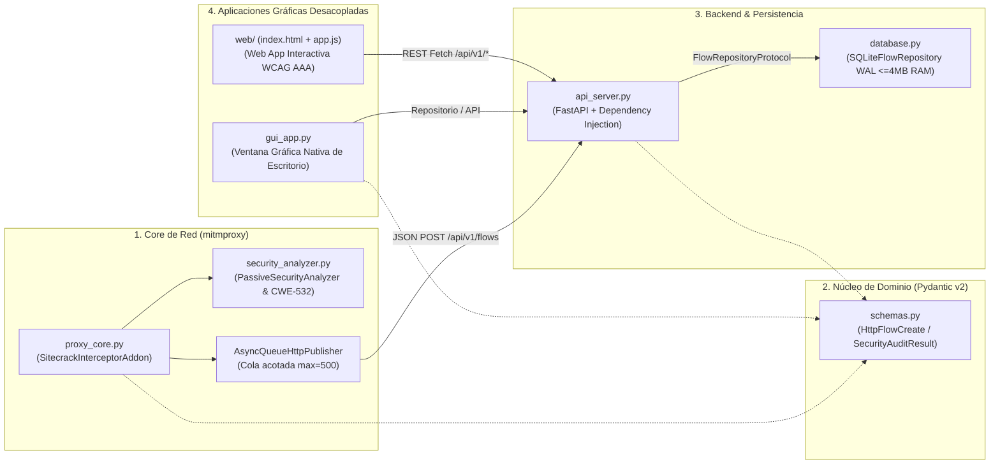

<div align="center">

# 🛡️ Sitecrack App // Graphical HTTP/S Inspector & Passive Security Auditor

<p align="center">
  <strong>Aplicación Gráfica (Escritorio Nativa y Web App) de Inspección HTTP/S y Diagnóstico Visual de Seguridad OWASP</strong><br/>
  <em>Diseñada bajo principios SOLID (Alta Cohesión y Bajo Acoplamiento), consumo mínimo de RAM y accesibilidad visual WCAG AAA.</em>
</p>

[](https://www.python.org/)
[](./run_app.py)
[](https://mitmproxy.org/)
[](https://fastapi.tiangolo.com/)
[](./src/ui/web/styles.css)
[](./LICENSE)

</div>

---

## 🖥️ Interfaz Gráfica de Usuario (App de Escritorio y Web Dashboard)

**Sitecrack** cuenta con una **aplicación gráfica completa e intuitiva** pensada para que cualquier persona entienda de un vistazo qué ocurre en cada petición web sin lidiar con comandos complejos:

```text
+---------------------------------------------------------------------------------------------------+
| [🛡️ Sitecrack App]     [＋ Cargar tráfico de muestra] [⚡ Simular petición] [🔍 Letra] [♿ Contraste] |
+---------------------------------------------------------------------------------------------------+
| 📊 Peticiones: 4   │   🔒 Cifradas (HTTPS): 3   │   🔓 Sin cifrar: 1   │   ⚠ Alertas (D/F): 1    |
+---------------------------------------------------+-----------------------------------------------+
| LISTA DE TRÁFICO CAPTURADO                        | INSPECTOR VISUAL PASO A PASO                  |
| [🔍 Filtrar por dominio o ruta...] [Método: Todos]| [🛡️ Diagnóstico Seguridad] [📋 Cabeceras] [📦] |
|---------------------------------------------------|-----------------------------------------------|
| #4  🔓 HTTP   POST  legacy-portal/auth   ✖ Nota F |  ✖ [Riesgo Alto] Tráfico HTTP sin cifrar      |
| #3  🔒 HTTPS  GET   app.corp-gateway     ▲ Nota C |  ✖ [Riesgo Alto] Falta cabecera HSTS          |
| #2  🔒 HTTPS  GET   cdn.hardened/bundle  ★ Nota A |                                               |
| #1  🔒 HTTPS  GET   api.hardened/health  ★ Nota A |  LISTA DE PROTECCIONES WEB (Guía Explicada):  |
|                                                   |  • Strict-Transport-Security   -> [✖ FALTA]   |
|                                                   |  • Content-Security-Policy     -> [✖ FALTA]   |
+---------------------------------------------------+-----------------------------------------------+
```

### ¿Qué incluye la Aplicación Gráfica?
1. **Doble Interfaz Gráfica a Elección (Gracias al Bajo Acoplamiento):**
   - **App de Escritorio Nativa (`python run_app.py` o doble clic en `Iniciar_Sitecrack_App.bat`):** Ventana nativa de Windows/Linux/macOS (`Tkinter / TTK`) con tabla interactiva, buscador instantáneo, pestañas explicadas y ventana modal para simular peticiones.
   - **Web App Interactiva (`python run_app.py --web` en `http://127.0.0.1:8000`):** Interfaz gráfica moderna servida directamente por FastAPI con conmutador de **Alto Contraste WCAG AAA** y botón de **Letra Grande (`A+`)**.
2. **Explicaciones en Lenguaje Claro:** En lugar de mostrar solo nombres técnicos como `X-Content-Type-Options`, el panel derecho explica qué hace cada protección, por qué importa y si está `✔ PRESENTE` o `✖ FALTA`.
3. **Simulador Integrado (`⚡ Simular petición`):** Permite crear y probar peticiones con distintos niveles de seguridad desde una ventana gráfica sin necesidad de configurar certificados en el navegador.

---

## 🏗️ Arquitectura del Sistema (SOLID & Bajo Acoplamiento)



---

## ⏱️ Cómo Abrir la Aplicación en 1 Clic

### Opción A: Ventana Gráfica de Escritorio (Recomendada)

Haz doble clic en **`Iniciar_Sitecrack_App.bat`** o ejecuta:

```powershell
python run_app.py
```

### Opción B: Aplicación Gráfica Web en el Navegador

```powershell
python run_app.py --web
```
*(Se abrirá automáticamente `http://127.0.0.1:8000` con el tráfico de ejemplo cargado).*

### Opción C: Conectar el Interceptor de Red `mitmproxy` (Opcional)

Si además de usar el simulador gráfico quieres interceptar tráfico real en el puerto `8080`:

```powershell
mitmdump -s src/core/proxy_core.py --listen-host 127.0.0.1 -p 8080
```

---

## 📁 Estructura del Proyecto

```text
Sitecrack/
├── run_app.py                    # Lanzador unificado en 1 clic (Escritorio + Web App)
├── Iniciar_Sitecrack_App.bat     # Acceso directo ejecutable para Windows
├── src/
│   ├── domain/
│   │   └── schemas.py            # Contratos inmutables Pydantic v2 (Cero acoplamiento)
│   ├── core/
│   │   ├── proxy_core.py         # Addon mitmproxy + cola asíncrona no bloqueante
│   │   └── security_analyzer.py  # Auditor pasivo OWASP + sanitizador CWE-532
│   ├── api/
│   │   ├── api_server.py         # Backend FastAPI + servidor de Web App + Simulador
│   │   └── database.py           # Repositorio SQLite WAL parametrizado (CWE-89 safe)
│   └── ui/
│       ├── gui_app.py            # Aplicación gráfica nativa de escritorio (Tkinter/TTK)
│       ├── web/                  # Aplicación gráfica Web (index.html, styles.css, app.js)
│       ├── api_client.py         # Cliente REST desacoplado + proveedor Demo
│       └── cli_app.py            # Modo consola opcional
├── tests/
│   └── test_sitecrack.py         # Suite de tests unitarios y de integración
└── README.md
```

---

## 🧪 Pruebas Automatizadas

```powershell
python -m pytest tests/test_sitecrack.py -v
```
