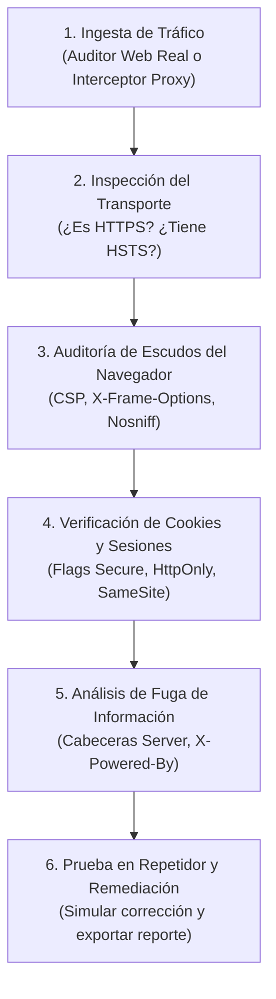
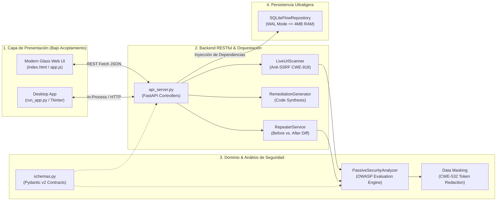

<div align="center">

# 🛡️ Sitecrack // Manual de Uso & Guía de Auditoría de Vulnerabilidades Web

<p align="center">
  <strong>Suite Gráfica de Intercepción HTTP/S, Diagnóstico Pasivo OWASP y Remediation Engineering</strong><br/>
  <em>Construida con principios SOLID (Alta Cohesión, Bajo Acoplamiento), arquitectura Glassmorphism WCAG AAA y cero fuga de memoria (RAM ≤ 4 MB).</em>
</p>

[](https://www.python.org/)
[](https://github.com/Kekkan74/Sitecrack/actions)
[](./src/ui/web/)
[](./src/core/)
[](./LICENSE)

[Guía de Uso Rápido](#-guía-de-uso-rápido-de-la-aplicación) • [Metodología de Análisis](#-cómo-hacer-el-análisis-de-una-web-paso-a-paso) • [Vulnerabilidades y Vectores de Ataque](#-matriz-de-vulnerabilidades-vectores-de-ataque-y-remediación) • [Arquitectura Técnica](#-arquitectura-del-sistema-solid)

</div>

---

## 🎯 ¿Qué es Sitecrack?

**Sitecrack** es una suite de seguridad web y proxy interceptador concebida para auditar el tráfico HTTP/S, identificar debilidades defensivas en aplicaciones web y generar código de solución inmediato. 

A diferencia de suites convencionales complejas de interpretar, Sitecrack transforma los metadatos de red en **diagnósticos visuales a todo color**, combinando un diseño estilo **Glassmorphism**, anillos gráficos de puntuación SVG (0 a 100), protección **Anti-SSRF**, repetidor con comparador antes/después y un generador automático de código de mitigación para los principales servidores del mercado.

```text
+------------------------------------------------------------------------------------------------------------------------+
| 🌐 Sitecrack   [📊 Total: 12]  [🔒 HTTPS: 11]  [🚨 Con avisos: 3]  [⚡ Media: 18ms] [Salud: 75% ██████░░]             |
+------------------------------------------------------------------------------------------------------------------------+
|  [ 🌐 Auditar Web Real ]   [ ＋ Simular prueba ]   [ 📄 Exportar Informe ]   [ Cargar ejemplos ]   [ A+ ]   [ ☾ Tema ] |
+-------------------------------------------------------------+----------------------------------------------------------+
| LISTA DE TRÁFICO CAPTURADO                                  | BANNER HERO GLASS (Puntuación & Escudos de Seguridad)    |
| [🔍 Buscar web o ruta...] [Filtrar: Todas ▼] [Método: ▼]   |  ( 90/100 ) 🟢 Conexión blindada: cuenta con HTTPS y     |
|-------------------------------------------------------------|  Nota A       escudos de seguridad activos.              |
| 🔒 GET  github.com            Nota A (90 pts)   200 · 142ms |  https://github.com/                                     |
| 🔒 GET  api.empresa.es/v1     Nota A (100 pts)  200 ·  24ms +----------------------------------------------------------+
| 🔒 GET  wikipedia.org         Nota F (20 pts)   200 ·  98ms | [🛡️ Avisos (1)] [🛠️ Cómo Solucionarlo] [🔁 Repetidor]   |
| 🔓 POST portal.legacy/auth    Nota F (0 pts)    500 ·  45ms |----------------------------------------------------------|
|                                                             | 🛠️ CÓDIGO DE SOLUCIÓN AUTOMÁTICO (FastAPI/Nginx/Apache):  |
|                                                             | add_header Strict-Transport-Security "max-age=63072000"; |
+-------------------------------------------------------------+----------------------------------------------------------+
```

---

## 🚀 Guía de Uso Rápido de la Aplicación

### 1. Iniciar la Aplicación en 1 Clic

| Método | Sistema Operativo | Comando / Acción |
| :--- | :--- | :--- |
| **Acceso Directo** | Windows | Doble clic sobre [`Iniciar_Sitecrack_App.bat`](file:///C:/adry/Git_proyectos/Sitecrack/Iniciar_Sitecrack_App.bat) |
| **Terminal / CLI** | Windows / Linux / macOS | `python run_app.py` |
| **Modo Web puro** | Servidores / Docker | `python run_app.py --no-browser` (disponible en `http://127.0.0.1:8000`) |

### 2. Recorrido por las Funciones Principales

1. **🌐 Auditar Web Real (Análisis en 1 Clic):**
   - Pulsa el botón verde **`🌐 Auditar Web Real`** en el banner superior.
   - Introduce cualquier dominio público (ej. `https://github.com`, `https://example.com`) o pulsa uno de los chips de prueba rápida.
   - Pulsa **"🚀 Conectar y Auditar Ahora"**: Sitecrack se conectará en vivo al objetivo, medirá la latencia real, evaluará sus cabeceras OWASP reales y mostrará la nota y los fallos al instante.
2. **📈 Anillo Gráfico de Puntuación (Score Ring) y Barra de Salud:**
   - El Hero Banner muestra un indicador circular SVG animado que evalúa la seguridad de **0 a 100** (Notas **A**, **B**, **C**, **D**, **F**).
   - En el encabezado, la **Barra Visual de Salud** muestra en tiempo real la proporción de conexiones seguras frente a las que presentan riesgos.
3. **🛠️ Pestaña "Cómo Solucionarlo" (Generador de Código Copy & Paste):**
   - Selecciona cualquier petición en la columna izquierda y abre la pestaña **`🛠️ Cómo Solucionarlo`**.
   - Verás el código de remediación exacto para aplicar las cabeceras que le faltan a ese sitio específico, con selector para:
     - 🐍 **FastAPI / Starlette** (Middleware en Python).
     - 🟢 **Nginx** (Directivas `add_header` y `server_tokens off`).
     - 🪶 **Apache** (Reglas `Header always set` para `.htaccess` o `httpd.conf`).
     - 🟩 **Node.js (Express)** (Middleware con `res.setHeader`).
   - Pulsa **"📋 Copiar código de solución"** para guardar el fragmento en el portapapeles.
4. **🔁 Repetidor en Vivo y Laboratorio de Corrección:**
   - En la pestaña **`🔁 Repetidor en Vivo`**, puedes editar el método HTTP, la URL y las cabeceras.
   - Usa los botones rápidos (ej. `＋ Añadir HSTS`, `＋ Añadir CSP` o `✨ Blindar Todo`) y pulsa **"🚀 Reenviar Petición y Comparar Nota"** para ver cómo sube la puntuación en el comparador *Antes vs. Después*.
5. **🍪 Inspector de Sesiones y Cookies:**
   - Revisa si las cookies de sesión incluyen los atributos críticos `Secure`, `HttpOnly` y `SameSite`.
   - Las cabeceras confidenciales (`Authorization: Bearer ...` y `Cookie`) son enmascaradas automáticamente bajo el estándar **CWE-532** para impedir fugas en registros.
6. **📄 Exportador de Informes Ejecutivos:**
   - Haz clic en **`📄 Exportar Informe`** en el banner superior para generar un reporte ejecutivo en HTML interactivo con tablas de hallazgos, métricas agregadas y diseño listo para imprimir o guardar en PDF (`Ctrl + P`).

---

## 🔍 Cómo Hacer el Análisis de una Web (Paso a Paso)

Para auditar la seguridad perimetral y la configuración de una aplicación web, sigue este flujo metodológico:



### Paso 1: Mapeo y Recolección
Introduce la URL del objetivo en el botón **`🌐 Auditar Web Real`** o navega a través del proxy interceptor (`mitmproxy` en el puerto `8080`). Sitecrack capturará la transacción completa sin alterar la aplicación original.

### Paso 2: Análisis de la Capa de Transporte (Cifrado)
Revisa si el esquema es `https://` y si la cabecera `Strict-Transport-Security` está presente:
- **¿Qué buscar?** Si la conexión viaja en `http://` plano o si le falta el parámetro `preload`.
- **Riesgo:** Si no existe HSTS, los usuarios pueden ser degradados a HTTP en redes no confiables.

### Paso 3: Análisis de Aislamiento en el Navegador
Examina los escudos del cliente en la pestaña **`🛡️ Avisos y Escudos`**:
- **CSP:** Comprueba si restringe la carga de scripts externos o si carece por completo de política.
- **X-Frame-Options:** Verifica si prohíbe ser incrustado en sitios de terceros.
- **X-Content-Type-Options:** Asegúrate de que tenga el valor estricto `nosniff`.

### Paso 4: Revisión de Cookies de Sesión
Abre la pestaña **`🍪 Sesiones y Cookies`**:
- Revisa las directivas `Set-Cookie` emitidas por el servidor. Cada cookie de sesión debe tener obligatoriamente `Secure; HttpOnly; SameSite=Lax` (o `Strict`).

### Paso 5: Huella del Servidor (Server Fingerprinting)
Revisa en la pestaña **`📋 Cabeceras`** si el servidor devuelve cabeceras como `Server: Apache/2.4.49` o `X-Powered-By: PHP/7.4`. Revelar la tecnología y su versión exacta facilita a los atacantes buscar vulnerabilidades conocidas (CVEs) asociadas a ese software.

### Paso 6: Generación de Soluciones y Validación
Pasa a la pestaña **`🛠️ Cómo Solucionarlo`**, copia la configuración recomendada para tu servidor e inyéctala en el **Repetidor** para comprobar que la nota sube a **A (100 pts)** antes de desplegar en producción.

---

## ⚠️ Matriz de Vulnerabilidades: Vectores de Ataque y Remediación

A continuación se detalla cada fallo detectado por Sitecrack, **el mecanismo de la vulnerabilidad, cómo un atacante intentaría explotarla teóricamente (modelo de amenazas)** y la **solución técnica defensiva**:

### 1. Ausencia de HSTS (`Strict-Transport-Security`)

* **Mecanismo:** El servidor no instruye al navegador a comunicarse exclusivamente mediante canales cifrados TLS.
* **Vector de ataque teórico (Cómo se atacaría):**
  - **Ataque de SSL Stripping / Man-in-the-Middle (MitM):** Un atacante situado en la misma red local (ej. Wi-Fi pública no segura) intercepta la primera petición HTTP del usuario antes de que ocurra la redirección a HTTPS (ej. mediante herramientas de intercepción ARP spoofing).
  - El atacante sustituye los enlaces HTTPS por enlaces HTTP transparentes, actuando de puente y leyendo credenciales, contraseñas y tokens en texto plano mientras el usuario cree estar navegando normalmente.
* **Impacto:** Robo de credenciales y secuestro de sesión en tránsito.
* **Remediación Defensiva:**
  ```http
  Strict-Transport-Security: max-age=63072000; includeSubDomains; preload
  ```

---

### 2. Ausencia o Debilidad de CSP (`Content-Security-Policy`)

* **Mecanismo:** El navegador no tiene una lista blanca que restrinja desde dónde se pueden cargar y ejecutar scripts, estilos, marcos u objetos.
* **Vector de ataque teórico (Cómo se atacaría):**
  - **Cross-Site Scripting (XSS):** Si la web presenta una vulnerabilidad de inyección (XSS reflejado o almacenado en comentarios, formularios o parámetros de búsqueda), el atacante inyecta una etiqueta `<script src="https://atacante.com/malware.js">` o código en línea `eval()`.
  - Sin CSP, el navegador de la víctima ejecuta el script en el contexto de seguridad de la víctima, permitiendo leer el DOM, capturar pulsaciones de teclas (keylogging), modificar el contenido de la página o exfiltrar datos privados.
* **Impacto:** Ejecución arbitraria de código JavaScript en el navegador del cliente.
* **Remediación Defensiva:**
  ```http
  Content-Security-Policy: default-src 'self'; script-src 'self'; object-src 'none'; frame-ancestors 'none';
  ```

---

### 3. Ausencia de Protección Anti-Clickjacking (`X-Frame-Options` / CSP `frame-ancestors`)

* **Mecanismo:** El servidor permite que sus páginas sean cargadas dentro de elementos `<iframe>`, `<frame>` u `<object>` de dominios externos no controlados.
* **Vector de ataque teórico (Cómo se atacaría):**
  - **Clickjacking (UI Redressing):** El atacante crea una página web maliciosa atractiva (ej. "¡Has ganado un premio, haz clic aquí!") y coloca encima la página legítima de la víctima (ej. la sección de transferencias bancarias o eliminación de cuenta) dentro de un `<iframe>` con opacidad `opacity: 0.0001` (invisible).
  - El atacante alinea estratégicamente el botón legítimo con el botón señuelo. Cuando la víctima hace clic en el señuelo visible, en realidad está pulsando el botón de la página víctima con su sesión autenticada.
* **Impacto:** Ejecución involuntaria de acciones privilegiadas por parte de usuarios autenticados.
* **Remediación Defensiva:**
  ```http
  X-Frame-Options: DENY
  ```
  *(O mediante CSP moderno: `Content-Security-Policy: frame-ancestors 'none';`)*

---

### 4. Ausencia de Anti-MIME Sniffing (`X-Content-Type-Options`)

* **Mecanismo:** Cuando un archivo no tiene un `Content-Type` explícito o el navegador sospecha que es incorrecto, intenta deducir su tipo analizando los primeros bytes del archivo (MIME sniffing).
* **Vector de ataque teórico (Cómo se atacaría):**
  - **Ataque de Confusión MIME / Stored XSS mediante Uploads:** Un atacante sube una supuesta imagen o archivo de texto `.txt` a un portal que permite subir avatares o documentos.
  - Sin embargo, dentro del archivo esconde código HTML y JavaScript (`<script>alert(1)</script>`). Si el servidor entrega el archivo sin `nosniff`, Internet Explorer u otros motores de renderizado pueden "adivinar" que se trata de código HTML y ejecutarlo como script en el dominio de la aplicación.
* **Impacto:** Bypass de filtros de subida de archivos y escalada a XSS persistente.
* **Remediación Defensiva:**
  ```http
  X-Content-Type-Options: nosniff
  ```

---

### 5. Fuga de Privacidad en Enlaces Salientes (`Referrer-Policy`)

* **Mecanismo:** Por defecto, los navegadores envían la URL completa de origen en la cabecera `Referer` al hacer clic en un enlace externo o al cargar recursos de terceros.
* **Vector de ataque teórico (Cómo se atacaría):**
  - **Information Disclosure / Fuga de Tokens en URL:** Si la aplicación utiliza rutas con parámetros sensibles en la query string (ej. `https://app.com/reset-password?token=a8f9c1b3` o `https://app.com/cliente?dni=12345678Z`), cuando el usuario pulsa un enlace a una web externa o a un anuncio, el servidor del tercero recibe la URL completa en la cabecera `Referer`.
  - El administrador del servidor externo o un atacante con acceso a sus logs puede reutilizar el token de restablecimiento o recopilar información personal (PII).
* **Impacto:** Filtración involuntaria de credenciales temporales, identificadores de sesión o datos personales.
* **Remediación Defensiva:**
  ```http
  Referrer-Policy: strict-origin-when-cross-origin
  ```

---

### 6. Ausencia de Restricción de Sensores (`Permissions-Policy`)

* **Mecanismo:** No se declaran restricciones sobre qué APIs avanzadas del navegador pueden ser invocadas por iframes o scripts integrados.
* **Vector de ataque teórico (Cómo se atacaría):**
  - **Abuso de Sensores en Publicidad de Terceros / Malvertising:** Si la web incluye widgets, SDKs analíticos o banners publicitarios de terceros y uno de ellos es comprometido, dicho script podría intentar solicitar acceso a la geolocalización, cámara, micrófono o acelerómetro del usuario utilizando la legitimidad y el origen de la web principal.
* **Impacto:** Espionaje de ubicación o captura no autorizada de periféricos del usuario.
* **Remediación Defensiva:**
  ```http
  Permissions-Policy: geolocation=(), microphone=(), camera=(), payment=()
  ```

---

### 7. Cookies de Sesión sin Flags Defensivos (`Secure`, `HttpOnly`, `SameSite`)

* **Mecanismo:** Las cookies de autenticación no contienen los atributos de seguridad estipulados por los estándares web.
* **Vectores de ataque teóricos:**
  - **Sin `HttpOnly` (Robo por XSS):** Si la web sufre un ataque XSS, el script malicioso puede ejecutar `document.cookie` y enviar la cookie de sesión directamente a un servidor controlado por el atacante. Con `HttpOnly`, JavaScript tiene denegado el acceso a la cookie.
  - **Sin `Secure` (Fuga en Red):** La cookie se enviará en cualquier petición HTTP no cifrada, permitiendo su intercepción pasiva en redes Wi-Fi abiertas.
  - **Sin `SameSite` (CSRF - Cross-Site Request Forgery):** Un sitio malicioso puede hacer que el navegador del usuario envíe una petición autenticada hacia la aplicación legítima (ej. `POST /api/transferir`), ya que el navegador adjuntará la cookie automáticamente si no está restringida a `SameSite=Lax` o `Strict`.
* **Remediación Defensiva:**
  ```http
  Set-Cookie: session_id=xyz123; Secure; HttpOnly; SameSite=Lax; Path=/
  ```

---

### 8. Exposición de Versión del Servidor (Server Fingerprinting)

* **Mecanismo:** El servidor responde con cabeceras que delatan su nombre y compilación exacta (ej. `Server: Apache/2.4.49` o `X-Powered-By: PHP/8.0.1`).
* **Vector de ataque teórico (Cómo se atacaría):**
  - **Reconocimiento Automatizado de CVEs:** Un atacante realiza un escaneo pasivo. Al detectar una versión vulnerable (como `Apache/2.4.49`), no necesita adivinar: consulta directamente bases de datos de vulnerabilidades (NVD / Exploit-DB) y aplica los exploits conocidos para esa versión específica (ej. `CVE-2021-41773` de Path Traversal y RCE).
* **Impacto:** Reduce drásticamente el tiempo de reconocimiento del atacante para encontrar vectores de explotación dirigida.
* **Remediación Defensiva:**
  - En **Nginx:** `server_tokens off;`
  - En **Apache:** `ServerTokens Prod` y `ServerSignature Off`

---

## 🏗️ Arquitectura del Sistema (SOLID & Resiliencia)

Sitecrack está diseñado para maximizar la cohesión y desacoplar cada subsistema mediante interfaces formales:



### Principios de Ingeniería Aplicados:
* **Single Responsibility Principle (SRP):** Cada módulo realiza una única función bien delimitada (el analizador no toca la base de datos; el escáner en vivo no genera HTML; los controladores solo validan peticiones).
* **Dependency Inversion Principle (DIP):** El servidor API interactúa con [`FlowRepositoryProtocol`](file:///C:/adry/Git_proyectos/Sitecrack/src/api/database.py), permitiendo reemplazar el almacenamiento SQLite por PostgreSQL o almacenamiento en memoria sin modificar una sola línea de lógica de negocio.
* **Defensa en Profundidad (AppSec):**
  - **Anti-SSRF (`CWE-918`):** [`LiveUrlScanner`](file:///C:/adry/Git_proyectos/Sitecrack/src/core/live_scanner.py) y [`_SSRFProtectedRedirectHandler`](file:///C:/adry/Git_proyectos/Sitecrack/src/core/live_scanner.py#L30) validan que ninguna petición inicial ni redirección (`301`/`302`) apunte a direcciones de loopback (`127.0.0.1`), rangos privados RFC 1918 ni metadatos cloud (`169.254.169.254`).
  - **Protección de Credenciales (`CWE-532`):** Las cabeceras `Authorization` y `Cookie` son sanitizadas mediante expresiones regulares antes de persistirse en base de datos.
  - **Inyecciones SQL Prevenidas (`CWE-89`):** Todas las consultas en [`SQLiteFlowRepository`](file:///C:/adry/Git_proyectos/Sitecrack/src/api/database.py) están estrictamente parametrizadas con placeholders `?`.

---

## 🧪 Pruebas Automatizadas y Calidad de Código

El repositorio incluye una batería completa de pruebas unitarias y de integración que verifican la arquitectura SOLID, el bloqueo Anti-SSRF, la generación de código de mitigación y la auditoría de sitios web reales:

```powershell
# Ejecutar la suite completa con pytest
python -m pytest tests/test_sitecrack.py -v
```

Resultado de la verificación automatizada:
```text
tests/test_sitecrack.py::test_security_analyzer_grades_and_secret_redaction PASSED [ 14%]
tests/test_sitecrack.py::test_sqlite_repository_and_fastapi_controllers_integration PASSED [ 28%]
tests/test_sitecrack.py::test_interceptor_addon_decoupled_publisher_and_ram_bound PASSED [ 42%]
tests/test_sitecrack.py::test_accessible_visual_formatters PASSED        [ 57%]
tests/test_sitecrack.py::test_repeater_before_after_comparison_and_ssrf_guard PASSED [ 71%]
tests/test_sitecrack.py::test_remediation_code_generator_for_stacks PASSED [ 85%]
tests/test_sitecrack.py::test_live_website_scanner_ssrf_block_and_real_public_web PASSED [100%]

============================== 7 passed in 1.77s ==============================
```

---

## ⚖️ Descargo de Responsabilidad y Uso Ético

**Sitecrack** ha sido diseñado como una herramienta de auditoría pasiva, diagnóstico de postura de seguridad y formación en ciberseguridad defensiva. 

* El análisis de aplicaciones web debe realizarse exclusivamente sobre **infraestructura propia** o sobre sistemas para los cuales se cuente con la **autorización explícita y por escrito** de su propietario.
* El análisis pasivo de cabeceras públicas simula peticiones de lectura ordinarias (`GET` / `HEAD`) equivalentes a la navegación web estándar, implementando restricciones Anti-SSRF para salvaguardar redes privadas e infraestructura crítica.
* Los autores y colaboradores no se hacen responsables del uso indebido de los conceptos explicados en esta guía.

---

## 📄 Licencia

Este proyecto está distribuido bajo la licencia **MIT**. Consulta el archivo [`LICENSE`](file:///C:/adry/Git_proyectos/Sitecrack/LICENSE) para más detalles.
