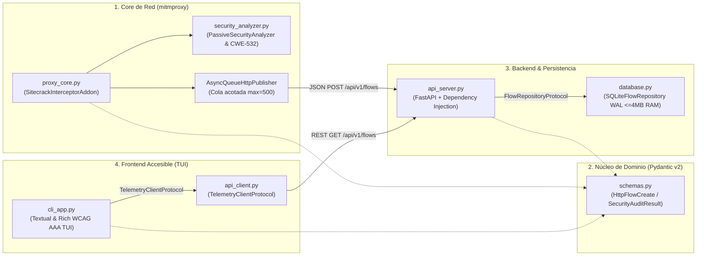

<div align="center">

# 🛡️ Sitecrack // Low-Memory HTTP/S Intercepting Proxy & Passive Security Auditor

<p align="center">
  <strong>Suite Modular de Inspección HTTP/S y Auditoría Pasiva de Cabeceras OWASP en Terminal (TUI)</strong><br/>
  <em>Diseñada bajo principios SOLID (Alta Cohesión y Bajo Acoplamiento), consumo mínimo de RAM y accesibilidad visual WCAG AAA.</em>
</p>

[](https://www.python.org/)
[](https://mitmproxy.org/)
[](https://fastapi.tiangolo.com/)
[-7928CA?style=flat-square&logo=windowsterminal&logoColor=white)](https://textual.textualize.io/)
[](./src)
[](./LICENSE)

</div>

---

## ⚡ Evidencia Visual en Terminal (Accessible TUI Output)

```text
$ python -m src.ui.cli_app --demo --snapshot
     🛡️ SITECRACK // Resumen Accesible de Tráfico Interceptado [DEMO DATA]     
┌────┬───────────┬────────┬─────────────┬────────────┬──────────┬─────────────┐
│ ID │ Protocolo │ Método │ Estado      │ Endpoint   │ Latencia │  Auditoría  │
├────┼───────────┼────────┼─────────────┼────────────┼──────────┼─────────────┤
│ #4 │  🔓 HTTP  │  POST  │ ✖ 500       │ legacy-po… │ 142.8 ms │ [✖ F |  10] │
│    │           │        │ SERVER      │            │          │             │
├────┼───────────┼────────┼─────────────┼────────────┼──────────┼─────────────┤
│ #3 │ 🔒 HTTPS  │  GET   │ ⚠ 403       │ app.corp-… │  48.3 ms │ [▲ C |  60] │
│    │           │        │ CLIENT      │            │          │             │
├────┼───────────┼────────┼─────────────┼────────────┼──────────┼─────────────┤
│ #2 │ 🔒 HTTPS  │  GET   │ ✔ 200 OK    │ cdn.harde… │  19.4 ms │ [★ A |  90] │
├────┼───────────┼────────┼─────────────┼────────────┼──────────┼─────────────┤
│ #1 │ 🔒 HTTPS  │  GET   │ ✔ 200 OK    │ api.harde… │  11.2 ms │ [★ A | 100] │
└────┴───────────┴────────┴─────────────┴────────────┴──────────┴─────────────┘
       Total: 4 | HTTPS: 3 | HTTP: 1 | Errores: 2 | Riesgo Alto (D/F): 1       
┌─────── Inspector Forense de Flujo #4 (legacy-portal.internal.local) ────────┐
│ ■ METADATOS DE TRANSACCIÓN                                                  │
│   ID Flujo   : #4  |  Timestamp: 2026-11-04T17:59:40Z                       │
│   Endpoint   : POST http://legacy-portal.internal.local/auth/session        │
│   Estado     : 500 | Latencia: 142.8 ms | Req 218 B / Resp 512 B            │
│                                                                             │
│ ■ AUDITORÍA PASIVA DE SEGURIDAD (Calificación: F - 10/100)                  │
│   ✖ [HIGH] Transport-Layer: Tráfico transmitido sobre HTTP sin cifrado TLS. │
│   ✖ [HIGH] Strict-Transport-Security: Ausencia de HSTS (riesgo downgrade).  │
│   ℹ [INFO] Server: Exposición de versión ('Apache/2.4.49 (Unix)').          │
│                                                                             │
│ ■ CABECERAS DE PETICIÓN (Sanitizadas CWE-532)                               │
│   Host: legacy-portal.internal.local                                        │
│   Authorization: [REDACTED:Bearer e...]                                     │
└─────────────────────────────────────────────────────────────────────────────┘
```

---

## 🏗️ Arquitectura del Sistema (SOLID & Bajo Acoplamiento)



### Aplicación de Principios SOLID

| Principio | Implementación Concreta en Sitecrack |
| :--- | :--- |
| **S — Single Responsibility (SRP)** | `proxy_core.py` solo intercepta el flujo de red; `security_analyzer.py` evalúa cabeceras OWASP; `database.py` gestiona SQLite; `cli_app.py` renderiza la interfaz en terminal. |
| **O — Open/Closed (OCP)** | Nuevas reglas de auditoría pasiva se agregan declarativamente en `DEFAULT_HEADER_RULES` (`HeaderRule`) sin tocar el interceptor ni la API. |
| **L — Liskov Substitution (LSP)** | `FastApiTelemetryClient` y `DemoTelemetryClient` implementan `TelemetryClientProtocol` y son intercambiables en caliente (tecla `D` en la TUI). |
| **I — Interface Segregation (ISP)** | Interfaces granulares (`FlowPublisherProtocol`, `FlowRepositoryProtocol`, `TelemetryClientProtocol`) que exponen únicamente los métodos requeridos por su consumidor. |
| **D — Dependency Inversion (DIP)** | Los controladores de FastAPI dependen de `Depends(get_repository)` (`FlowRepositoryProtocol`) y el addon de mitmproxy recibe `FlowPublisherProtocol` por inyección en constructor. |

---

## ♿ Diseño Visual y Accesibilidad (WCAG AA/AAA)

1. **Independencia Cromática (Daltonismo / Deuteranopía / Protanopía):** Ningún estado depende únicamente del color. Todos los códigos HTTP, protocolos y calificaciones incorporan **iconografía geométrica redundante y etiquetas textuales**:
   - Estado HTTP: `✔ 200 OK`, `↪ 302 REDIR`, `⚠ 403 CLIENT`, `✖ 500 SERVER`
   - Transporte: `🔒 HTTPS` vs `🔓 HTTP`
   - Postura de Seguridad: `[★ A | 100]`, `[◆ B | 85]`, `[▲ C | 60]`, `[✖ F | 10]`
2. **Modo Ultra-Contraste Monocromático (`H` o `--high-contrast`):** Conmutación instantánea a blanco sobre negro puro (`#FFFFFF` / `#000000`) con bordes dobles de enfoque para baja visión.
3. **Modo Snapshot (`--snapshot`):** Impresión lineal estructurada compatible con lectores de pantalla y tuberías de consola.

---

## ⏱️ Puesta en Marcha en 60 Segundos

### 1. Aprovisionar el Entorno

```bash
# En Linux / macOS / Git Bash:
bash scripts/setup_env.sh

# En Windows PowerShell:
powershell -ExecutionPolicy Bypass -File .\scripts\setup_env.ps1
```

### 2. Probar Inmediatamente la Interfaz (Modo Demo Cero-Fricción)

```bash
# Vista instantánea en terminal estándar
python -m src.ui.cli_app --demo --snapshot

# Interfaz interactiva completa (TUI)
python -m src.ui.cli_app --demo
```

### 3. Levantar el Stack Completo de Intercepción Local

```bash
# Terminal 1: Backend FastAPI + SQLite WAL
uvicorn src.api.api_server:app --host 127.0.0.1 --port 8000

# Terminal 2: Interceptor mitmproxy en puerto 8080
mitmdump -s src/core/proxy_core.py --listen-host 127.0.0.1 -p 8080

# Terminal 3: Consola TUI en vivo
python -m src.ui.cli_app
```

---

## ⚖️ Decisiones de Ingeniería y Optimización de RAM (ADR)

| Decisión | Enfoque Elegido | Alternativa Descartada | Justificación Técnica |
| :--- | :--- | :--- | :--- |
| **Consumo de RAM en Proxy** | Truncado estricto a `2048 bytes` (`MAX_PREVIEW_BYTES`) + cola `maxsize=500` | Almacenar cuerpos HTTP completos en memoria | Evita picos de gigabytes de RAM cuando el navegador descarga vídeos, imágenes o bundles JS pesados a través del proxy. |
| **Motor de Base de Datos** | `sqlite3` nativo con `journal_mode=WAL` y `cache_size=-4000` (4 MB) | SQLAlchemy ORM + PostgreSQL | Cero sobrecarga de objetos ORM, lecturas concurrentes sin bloqueo desde la TUI y huella de memoria inferior a 15 MB. |
| **Seguridad en Almacenamiento** | Consultas 100% parametrizadas (`?`) + redacción `CWE-532` | Interpolación de cadenas / guardado en bruto | Previene inyección SQL a través de URLs o cabeceras manipuladas y evita fugas de tokens `Authorization` / `Cookie` en disco. |

---

## 📁 Estructura del Proyecto y Pruebas

```text
Sitecrack/
├── src/
│   ├── domain/
│   │   └── schemas.py            # Contratos inmutables Pydantic v2 (Cero acoplamiento)
│   ├── core/
│   │   ├── proxy_core.py         # Addon mitmproxy + cola asíncrona no bloqueante
│   │   └── security_analyzer.py  # Auditor pasivo OWASP + sanitizador CWE-532
│   ├── api/
│   │   ├── api_server.py         # Endpoints REST FastAPI con Inyección de Dependencias
│   │   └── database.py           # Repositorio SQLite WAL parametrizado (CWE-89 safe)
│   └── ui/
│       ├── api_client.py         # Cliente REST desacoplado + proveedor Demo
│       └── cli_app.py            # TUI accesible Textual/Rich con soporte WCAG AAA
├── tests/
│   └── test_sitecrack.py         # Suite de tests unitarios y de integración
├── scripts/
│   ├── setup_env.sh              # Inicializador Bash
│   └── setup_env.ps1             # Inicializador PowerShell
├── requirements.txt
└── README.md
```

Ejecutar la suite de pruebas automatizadas:

```bash
pytest -v
```

---

## ⚠️ Uso Ético y Alcance Operativo

**Sitecrack** es una herramienta de **inspección pasiva, depuración de desarrollo y auditoría defensiva de cabeceras HTTP/S** diseñada para operar en `localhost` (`127.0.0.1`). Solo debe utilizarse sobre aplicaciones propias, entornos de laboratorio o sistemas para los cuales se disponga de autorización expresa.
